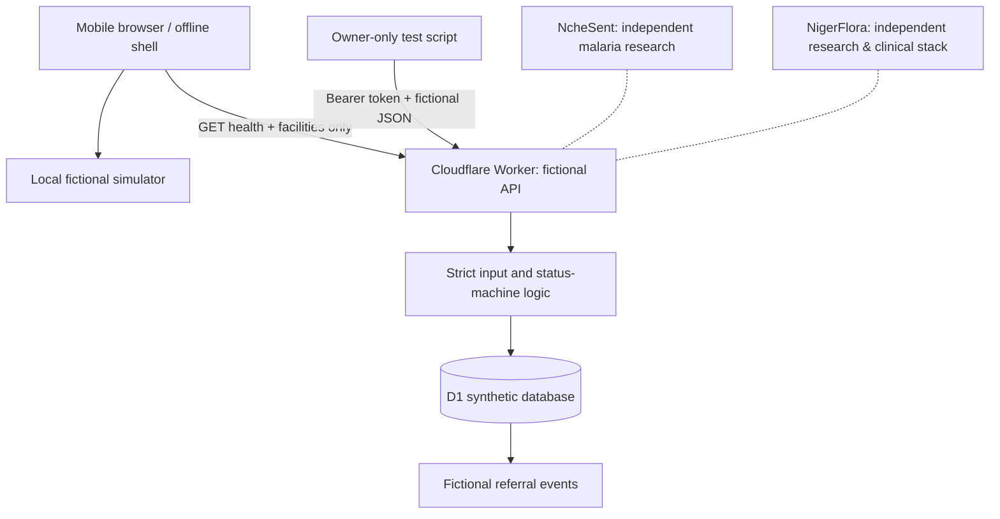

# NcheNne Health Network — Fictional Referral Demonstrator

**Engineering version 0.2.0 · Nigeria · Cloudflare Workers / D1**

> **NONCLINICAL, FICTIONAL TESTING ONLY.** This repository is **not** a healthcare service.
> It does not verify hospital availability, receive real patients, conduct triage,
> reserve beds, contact clinicians or dispatch emergency transport. Do not submit
> symptoms, names, contact details, patient records, or actual facility information.

NcheNne models accountable maternal referral coordination **without** a real patient
or clinic. It is a new independent project, not a replacement for
[NcheSent](https://github.com/mabrig1/NcheSent) or
[NigerFlora PharmaOS](https://github.com/mabrig1/naijamed-ai-).
There is **no operational data exchange with either application**.

## What can be demonstrated

- Browser-local, responsive fictional referral scenarios, language selection
  (English, Nigerian Pidgin, Igbo, Yoruba, Hausa — **not clinically reviewed**),
  offline static shell, sample analytics, and CSV export.
- Three fictional PHCs plus three fictional referral hospitals; no real addresses,
  contact details, people, patient fields, or institutional claims.
- Reporting example beds, staffing, theatre and blood-service indicators;
  45-minute expiration, capability matching and explicit referral acceptance.
- State machine: `offered → accepted → arrived → completed`, with decline,
  escalation and expiry. An *offer is not a reservation or acceptance*.
- A separate Cloudflare Worker API with D1 persistence for strictly **fictional**
  referrals and capacity reports. Demo writes require a server-side owner token.
- A read-only Worker/D1 health and facility-status connection panel, plus an
  **opt-in remote fictional-referral ledger inspector** that fetches only on click.
  The inspector validates an exact all-fictional response contract, rejects unknown
  fields, strips event details and safely displays a restricted status-only view.
  It never receives or transmits an API token or writes to D1.
- Interactive referral cards remain **browser-local**; the read-only D1 inspector
  does not synchronize or replace those scenarios. It cannot represent any
  referral as an active clinical case.
- Optimistic state-version checks and atomic D1 update/event batches for synthetic
  referral event history; unique demo referral-code and event constraints.
- Fail-closed health/readiness when fictional D1 is unbound or live mode is
  accidentally enabled; `clinicalUse` and `liveOperations` remain false.
- Repeatable fictional local D1 smoke tests, persistence across an actual
  Worker restart, and dual-request acceptance concurrency verification in CI.
  **These do not establish remote database durability or clinical safety.**

## Code review and verification

This work is staged in the **draft** [PR #1](https://github.com/mabrig1/NcheNne/pull/1).
Do not merge or publish as clinical software based on a passing build.

On GitHub Actions the quality gate runs:
```bash
npm run check              # Node unit tests and syntax validation
npx wrangler deploy --dry-run --config wrangler.ci.jsonc --outdir .wrangler-dry-run
npx wrangler d1 migrations apply nchenne_ci_placeholder_only --local --config wrangler.ci.jsonc
```
The isolated local-D1 job additionally launches Wrangler locally with a temporary
random token and runs `npm run smoke:demo`. It verifies that anonymous writes
are blocked; that fictional facility reports seed; and that create, accept,
arrive and complete transitions work, while rejecting identifiers, unavailable
facilities, premature arrival and duplicates.

The `wrangler.ci.jsonc` configuration uses a **dummy D1 UUID** for CI/local testing
only. The real `wrangler.jsonc` deliberately retains the invalid
`REPLACE_WITH_D1_DATABASE_ID` placeholder; **remote deployment is not configured.**

### Basic local static demonstration

Clone the repository, then open `public/index.html` in a modern browser.
Use **Referrals →** choose a fictional scenario, simulate staff acceptance,
mark fictional arrival and completion, and view its timeline. Try deliberately
stale capacity reports in **Facilities**. No backend required for this browser
exercise.

### Local Worker and D1 demonstration (no external resources)

Requires Node.js 22 or later. Only perform these commands in a development
environment, with **fictional** test records.

```bash
npm install
npm run check
npx wrangler d1 migrations apply nchenne_ci_placeholder_only --local --config wrangler.ci.jsonc
```

Create an untracked local `.dev.vars` file containing a random demo-only
`DEMO_API_TOKEN` of 24 characters or longer; do not use a real secret and never
commit, paste or log it. Start the development server:
```bash
npx wrangler dev --config wrangler.ci.jsonc --ip 127.0.0.1 --port 8787
```
In a separate shell, set `DEMO_API_TOKEN` to the same value and run:
```bash
NCHENNE_BASE_URL=http://127.0.0.1:8787 npm run smoke:demo
```
The test script creates **only** random `SIM-...` IDs. Its requests are intentionally
rejected for identifying fields, unknown facilities, incomplete transitions and
non-fictional cases.


### Inspect fictional D1 records (read-only, explicit opt-in)

When the application is served from a configured Worker and the fictional D1
database is reachable, the top banner reports the connection. Click
**Inspect fictional D1 ledger (read-only)** to fetch only the demo referral
statuses and event counts. No bearer token is used, no clinic or patient record
is permitted, and nothing is cached in the offline service worker. The view
uses a defensive all-fictional allowlist and `textContent` rather than HTML
injection. If D1 is not connected, the inspector stays disabled.

This is a **read-only bridge**, not a production referral dashboard. Synthetic
referrals produced by the local role-play UI remain separate from D1.

## API and persistence contract

| Method | Route | Purpose |
|---|---|---|
| GET | `/api/health` | Returns `clinicalUse:false` and `liveOperations:false` |
| GET | `/api/facilities` | Returns fictional facility reports |
| GET | `/api/referrals` | Fictional-only audit-backed referral timeline |
| POST | `/api/demo/seed` | Initialize fictional facilities (owner token) |
| POST | `/api/capacities/report` | Submit fictional capacity report (owner token) |
| POST | `/api/referrals` | Create a synthetic offer (owner token) |
| POST | `/api/referrals/:id/{accept,arrive,complete,decline,escalate,expire}` | Simulate a state change (owner token) |

All POST bodies require `demoOnly:true` with an exact allowlist of fields.
The Worker refuses `LIVE_CLINICAL_ENABLED=true` and rejects an unconfigured D1
binding. The API token is **not** clinician/hospital multiuser authentication.
All generated referrals are synthetic, even when retrieved from D1.



## Release blockers and governance

**A separately named private fictional staging Worker now exists.** On
25 October 2026, authenticated checks of the Access-protected
`nchenne-staging.victoryonline1.workers.dev` returned HTTP 200 for health,
fictional aggregate and facility endpoints. The D1 aggregates contained
**zero fictional facilities/referrals** at that point; no remote writes were run.
The exact live D1 database identity and deployed GitHub commit provenance have
**not yet been conclusively reconciled**. This repository remains a nonclinical
demonstration, not a patient-validated application. The existing
`nchenne.mabrigkorie.org` production Worker is separate and unchanged.
Do not use `wrangler.ci.jsonc` for remote deployment. `robots.txt` and
`<meta name="robots">` reduce indexing but do **not** secure access.
See [verified staging audit and release gates](docs/STAGING_VALIDATION_RUNBOOK.md).

Before an **isolated fictional** hosted preview, review account scope, cost
implications and private access controls. See
[Safe preview deployment](docs/SAFE_PREVIEW_DEPLOYMENT.md) and
[Safety and deployment limitations](docs/DEPLOYMENT_AND_SAFETY.md).

**Before considering any real clinical platform**, establish institution-level
contracts, independent maternal-health clinical governance, validated multilingual
safety pathways, verified staff credentials, patient-information consent/authority,
privacy impact assessment, applicable NDPC compliance, operational emergency
escalation, transport arrangements, audit/security review and supervised field
evaluation. Clinical deployment must be a separate approved programme.

**For an actual pregnancy emergency, seek immediate in-person medical care.**
This simulator is not an emergency-contact or referral service.


## Fictional coordination review queue

The read-only `GET /api/demo/watchlist` endpoint highlights fictional
administrative handoffs: stale sample capacity reports, zero-bed receiving
facilities, sample offers without acknowledgment, accepted simulated referrals
without arrival updates, and demonstration escalations. The optional browser
review button retrieves a **bounded, sanitized, strictly fictional-only** view.
There is no client API token, clinical AI, medical urgency score, automated
messaging, transport dispatch or real patient monitoring.

The simulated 10-minute offer and 30-minute arrival intervals are **UI exercise
examples, not safe waiting periods or clinical performance standards**.
See [fictional review cue rules](docs/COORDINATION_REVIEW_CUES.md) before
changing the thresholds or showing the demo to healthcare partners.


## Optional OpenRouter — **OFF by default**

NcheNne can optionally use your existing OpenRouter API key for **owner-only,
fictional administrative workflow explanations**. No natural-language questions,
clinical inputs or database records are sent to the provider.

- The key goes only into Cloudflare's encrypted **`OPENROUTER_API_KEY`**
  Worker secret. Never put it in the UI, GitHub, or chat.
- `OPENROUTER_ENABLED=false` and `OPENROUTER_MODEL=""` are defaulted in
  the Worker configs. To opt in after Access and cost reviews, select a
  **specific available model ID ending in `:free`** and explicitly enable.
- `GET /api/demo/ai/status` displays readiness without the key.
- `POST /api/demo/ai/explain` is owner-demo-token protected and accepts
  only a fixed simulated scenario code (no user-written text). It never
  changes referral state or sends notifications.
- The outbound API uses ZDR/no-data-collection routing, no paid fallback,
  a 96-token output cap and no retries. This is **not** an account-wide
  spending cap: configure OpenRouter account/key guardrails separately.
- **No live API calls or OpenRouter costs are incurred by the repository's
  unit tests or by the disabled default setting.**

See the exact manual configuration steps in
[OpenRouter setup](docs/OPENROUTER_CONFIGURATION.md).


### Engineering review hardening (31 October 2026)

The draft-only staging checks now reject unreviewed Cloudflare bindings and
resource/variable configuration. The fixed-host, GET-only preflight also checks
`/api/demo/ai/status` to require that optional AI inference remains disabled.
These gates do **not** authenticate Cloudflare Access scope or prove a remotely
deployed commit. See `docs/STAGING_VALIDATION_RUNBOOK.md`; no clinical use,
remote writes, paid inference or production deployment is authorized.


### Third-party review: safety-first quick fixes (31 October 2026)

The draft browser simulation and Worker state machine now prevent the
`escalated → arrived` shortcut; an explicit simulated acceptance is required.
An escalated offer may go to `accepted` only while the fictional offer window
remains valid, or to `declined`/`expired`. A **10-minute illustrative
fictional clock** blocks late acceptance and the browser automatically expires
outstanding local offers while open; manual expiry is available. It is
**not** a medical response-time target, real emergency alert, Worker cron
schedule or remote D1 expiry task.

Browser session state is now versioned; older session fixtures reset to
avoid stale schema replay. Mobile navigation includes Ecosystem, whole-page
live announcements were removed and hosted PWA paths are relative for
subpath hosting. The service worker caches only static fictional shell assets
within its own scope and never caches `api/` responses.

The repository root `index.html` remains the single-page, browser-local
standalone simulation; `public/index.html` adds strictly read-only Worker
inspector integration and must be served with companion static scripts.
Do **not** claim that a full PWA is installable on `file://`; service workers
require an eligible secure origin. These changes do not confer clinical readiness.


### Stakeholder-ready fictional-demo UX additions (31 October 2026)

- **Guided walkthrough:** one click runs six narrated-text local-only steps:
  refresh sample report, evaluate fully eligible fictional matches, create offer,
  accept, arrive and complete. It never sends data to Worker/D1, dispatch or
  external services. The Stop button cancels the timed presentation.
- **Network diagram:** three made-up PHCs and three made-up receiving sites
  connected by illustrative lines, expressly **not a map** or live directory.
- **Illustrative ranking:** only already fully eligible fictional facilities are
  ranked by sample beds and report freshness. There is **no clinical triage,
  proximity inference, partial-match suggestion or real transport planning**.
  Coordinator role-play selects an eligible facility. Declined or expired
  attempts can produce a *new separate fictional offer* without modifying
  previous immutable local timeline entries.
- **Research demo indicators:** mean fictional offer-to-accept and offer-to-arrival
  durations, plus locally downloadable timestamped role-event CSV. They
  represent only a simulated browser exercise, not real service performance.
- **Standalone downloadable artifact:** `NcheNne_Interactive_Demo.html`
  contains the browser-local simulation, inline styles, and zero network imports.
  Download and open it directly for a no-server stakeholder demonstration.
  On a `file://` URL it is **not a PWA**; the separate hosted `public/`
  application has extra read-only D1 components.

**Future scope, not implemented:** QR/phone handoff, real routing and distance
scores, clinical case-profile logic, validated translation/TTS, external
feedback, TypeScript refactor, real event sourcing, and real patient workflow.
These require separate safeguards, research or clinical review.
