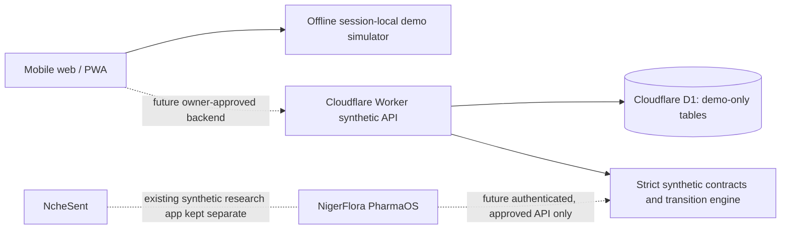

# NcheNne Health Network

**v0.1 — fictional/synthetic maternal emergency referral workflow prototype for Nigeria.**

> **DO NOT USE FOR REAL PATIENTS OR LIVE EMERGENCIES.** The app does not perform triage, offer medical advice, dispatch transport, verify actual facilities, or connect to any emergency service. Hospital data and referrals are fictional and simulated. No real patient information is permitted.

NcheNne is a new, **independent** product. It does **not** replace or alter NcheSent (existing synthetic malaria research application) or NigerFlora PharmaOS. No live integration, code changes, secrets, or data sharing have been made to those projects.

## What works now

- Attractive responsive desktop/mobile interface with an installable, offline-capable shell and no external JavaScript/CSS dependencies.
- Fictional Ebonyi example network: 3 PHCs and 3 receiving facilities with explicitly fictional names.
- Report limited service capabilities: usable beds, skilled maternity team, theatre and blood-service flags.
- Freshness logic: examples expire after 45 minutes; cannot claim availability from stale or absent reports.
- Match **only fictional referral hospitals** with fresh reports and all selected required capabilities.
- Create fictional referral offer with unique demonstration code (not a real booking or clinical judgment).
- Transition offer → facility accepted → arrival → completed, or explicit decline/escalation/expiry, with event timeline.
- Failure simulation (mark capacity stale), reset, aggregate dashboard, synthetic CSV export.
- Language selection: English, Nigerian Pidgin, Igbo, Yoruba, Hausa for main UI phrases. **Translations have not been clinically reviewed** and are not to be used for safety-critical messaging.
- Session-scoped demo state; no patient details, photos, phone numbers, precise geolocation or diagnostic data.
- Cloudflare Worker **synthetic-only** backend with D1 schema and owner-secret guarded mutation endpoints. The browser demo deliberately runs locally and is not connected to live Worker writes.
- Domain and backend safety tests.

## Run now — zero external services

Requirements: Node.js >= 20.

```bash
npm run preview
# Visit http://localhost:4173
```

No npm installation required to use this standalone static demo! `npm run preview` starts a minimal Node HTTP file server. For a single-file standalone copy, use `NcheNne_Interactive_Demo.html` distributed alongside the ZIP.

In the UI: select **Referrals**, choose a fictional scenario, then simulate staff acceptance, arrival confirmation and completion. Try **Facilities → Mark demo reports stale**, then attempt another match. Note how stale or incapable sites are rejected.

## Tests

```bash
npm test
npm run check
```

## Cloudflare Worker/D1 — optional synthetic API foundation

> These operations create or mutate external infrastructure. Run only after account-owner approval, confirming free tier usage, resource names and access policy.

1. Install dev tools: `npm install`.
2. Create a separate D1 **demo** database: `npx wrangler d1 create nchenne_demo`.
3. Copy returned `database_id` to `wrangler.jsonc` (replace placeholder). No production patient DB is supported.
4. Set an owner-only secret with `npx wrangler secret put DEMO_API_TOKEN`, using a long random value. Never paste the secret into UI code, Git or chat.
5. Locally run migrations: `npm run db:migrate:local`.
6. Develop with `npm run dev`; `/api/health` returns `clinicalUse:false` and `liveOperations:false`.
7. To seed fictional data, use an owner-authorized `POST /api/demo/seed` with JSON `{ "demoOnly": true }` and `Authorization: Bearer <owner-secret>`.
8. Before any remote deploy or D1 remote migration, review Cloudflare project privacy, access control and account billing with the owner. `npm run deploy` is **not** a clinical launch.

The production Worker is **deliberately fail-closed** unless `APP_MODE=synthetic_demo`, `LIVE_CLINICAL_ENABLED=false`, a D1 demo binding exists, and secret authentication is provided for writes. Never change `LIVE_CLINICAL_ENABLED` to `true`; there is no clinical implementation behind that flag.

### Synthetic Worker endpoints

| Method | Path | Purpose |
|---|---|---|
| GET | `/api/health` | Public nonclinical state |
| GET | `/api/facilities` | Fictional facilities in D1 |
| GET | `/api/referrals` | Fictional aggregate-independent event ledger; contains no patient data |
| POST | `/api/demo/seed` | Owner-token protected seed |
| POST | `/api/capacities/report` | Owner-token protected fictional capacity report |
| POST | `/api/referrals` | Owner-token protected synthetic offer; strict allowed-field check |
| POST | `/api/referrals/:id/accept` | Owner-token protected simulated acceptance |
| POST | `/api/referrals/:id/arrive` | Owner-token protected simulated arrival |
| POST | `/api/referrals/:id/complete` | Owner-token protected simulated completion |
| POST | `/api/referrals/:id/decline` | Owner-token protected simulated decline |
| POST | `/api/referrals/:id/escalate` | Owner-token protected simulated escalation |
| POST | `/api/referrals/:id/expire` | Owner-token protected simulated expiry |

**All** write requests must carry `demoOnly:true`. The system cannot accept patient identifying details by its allowed-field contracts. The front end intentionally uses only local fictional data; backend seed and writes are reserved for API development.

## Architecture



## Hard safety boundaries

- No real hospital claims, referral bookings, dispatch, clinical recommendations, or external sends.
- All data are fictional and marked as such. UI translations require review.
- Any future live platform requires real authentication, institutional credential checks, threat modeling, clinical governance, legal basis/DPIA, audited role-based access, incident response, communication-provider review, procurement and hospital agreements, access-controlled logs, and external validation.
- The Worker token protects synthetic admin writes but **is not** hospital-grade multiuser authentication.
- Prototype role simulation is NOT authorization; real patient workflows must not reuse it.
- No endorsement or operational involvement by named organizations is asserted.

Read `docs/SAFETY_AND_GOVERNANCE.md`, `docs/ECOSYSTEM_INTEGRATION.md` and `docs/ROADMAP.md` before adding features.

## GitHub quick start

Open `index.html` directly in a modern browser for the standalone fictional simulator. The full Worker/D1 source is available in the separately packaged source archive delivered in ChatGPT; this repository's hosted demo currently contains the portable standalone app. Do not represent this GitHub repository as a clinically approved service or live D1 deployment.
